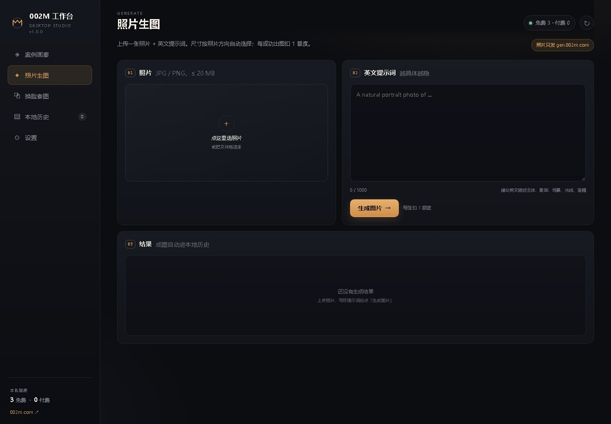
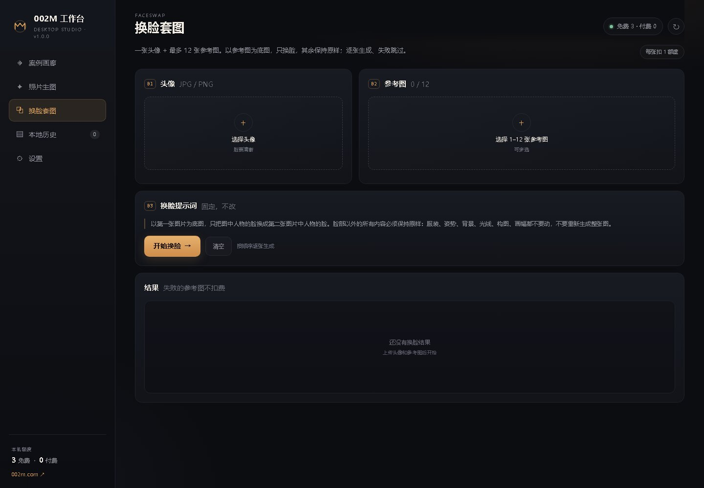

# 002M 工作台

002M 的桌面客户端 v1.0.0：把官网案例画廊、照片生图、换脸套图和本地作品历史放进一个离线可开的窗口。

- 技术栈：Go + Wails v3，前端是纯 HTML / CSS / JavaScript
- 不依赖 Node、npm、Vite，也没有前端打包器
- 本地 SQLite 历史，成图落在自己的硬盘上
- 只连 `gen.002m.com` 和 `www.002m.com`，只监听 `127.0.0.1`
- 不做账号登录、社区、插件、婚纱 / 试衣间 / 画布等 v1 之外的功能


## 功能

**案例画廊**：内置 295 条案例快照，支持关键词搜索和标签筛选。缩略图按需从官网拉取并缓存在本地，点开卡片可以看到大图、中英文提示词和 remix 变量，一键把提示词带到生图页。


**照片生图**：拖入或选择一张 JPG / PNG，写提示词，按原图比例生成。失败不扣额度；成功后图片同时落到本地作品目录和在线历史。



**换脸套图**：一张头像 + 最多 12 张参考图，逐张换脸，每张独立展示结果。



**本地历史**：SQLite 记录提示词、生成时间、来源和星标，支持搜索、按来源 / 星标筛选、导出、打开作品目录和删除。文件在本地，重启不丢。

**设置**：查看设备 ID、免费 / 付费额度、兑换码入口、代理模式（手动 / 环境变量 / 系统代理）、检查更新和隐私说明。

## 下载与安装

发布包由 GitHub Actions 构建，到 [Releases](https://github.com/shu3971/002m-workbench/releases) 下载：

- Windows：`002m-workbench-windows-amd64.exe`，单文件，双击即开
- macOS Apple Silicon：`002m-workbench-macos-arm64.zip`，解压后把 `.app` 拖进「应用程序」
- `SHA256SUMS`：两个产物的 SHA256，下载后可自行校验

系统要求：Windows 10/11（WebView2，Win11 自带；Win10 首次运行会提示安装）；macOS 12 及以上。

### 未签名打开

v1 没有代码签名，系统会拦一次，这是正常的：

- Windows：SmartScreen 提示「Windows 已保护你的电脑」→「更多信息」→「仍要运行」
- macOS：右键点 `.app` →「打开」→ 再点「打开」；或在终端执行
  `xattr -dr com.apple.quarantine "/Applications/002M 工作台.app"`

## 使用

1. 打开「案例画廊」，找一张想改的图，点「用这个提示词」。
2. 到「照片生图」，拖入自己的照片，按需改提示词，点生成。
3. 想保留某张成图，到「本地历史」加星标；需要交付时点「导出」。
4. 额度不够时在「设置」里粘贴兑换码，或点「购买额度」去官网。

设备 ID 是本地生成的 12 位标识，存在用户目录的 `.002m/device-id`。它对应 002M 的免费 / 付费额度；换设备就是新额度，删掉这个文件也会变成新设备。客户端不接触账号密码。

## 数据与隐私

默认数据目录：

- Windows：`%APPDATA%\002M Workbench`
- macOS：`~/Library/Application Support/002M Workbench`

目录里有：

- `history.db`：SQLite 历史
- `works/`：生成的图片原图
- `cache/thumbs`、`cache/cases`：缩略图和案例原图缓存
- `exports/`：导出目录
- `workbench.log`：本地运行日志

数据边界：

- 应用只在本机 `127.0.0.1` 上开 HTTP 服务，随机端口；每次启动生成随机会话 token，API 必须带 `X-002M-Token`，图片 URL 必须带 `t` 参数
- 不上报埋点，不读取通讯录 / 相册 / 浏览器数据
- 生成请求只发给 `https://gen.002m.com`，案例图和缩略图只从 `https://www.002m.com` 拉取
- 图片默认只存本地；`gen.002m.com` 的在线副本按其规则约 30 天后清理
- 代理可选，配置只存本地 SQLite

## 从源码构建

需要 Go 1.26+ 和 Wails v3.1.0。Windows 还需要 WebView2 和 Git Bash（Wails 的 Taskfile 用 `sh`）；macOS 需要 Xcode Command Line Tools。

```bash
go install github.com/wailsapp/wails/v3/cmd/wails3@v3.1.0
git clone https://github.com/shu3971/002m-workbench.git
cd 002m-workbench
wails3 build                 # Windows：bin/002m-workbench.exe
wails3 package               # macOS：bin/002m-workbench.app
```

Windows 产物：`bin/002m-workbench.exe`；macOS 产物：`bin/002m-workbench.app`。

macOS 发布包在 CI 上用 `GOOS=darwin GOARCH=arm64 CGO_ENABLED=0 go build -tags "production,purego"` 交叉构建，再按 `build/darwin/Info.plist` 组装 `.app` 并打 zip；本机没有 Apple Silicon 真机，因此只验证了包结构，未做 macOS 启动实测。

前端就在 `frontend/dist`，改完直接重新 `wails3 build`，没有 `npm install`，也没有 `wails3 dev` 热更新。

### 无窗口冒烟

```bash
./002m-workbench.exe -headless -addr 127.0.0.1:18080
# 另开终端
curl -H "X-002M-Token: <启动时打印的 TOKEN>" http://127.0.0.1:18080/api/bootstrap
```

`-headless` 会打印 `LISTEN=` 和 `TOKEN=`，适合 CI / 本机接口回归。

## 架构

```
main.go        Wails 窗口 + 本机 HTTP 服务 + 静态资源
server.go      路由、token 校验、缩略图 / 原图 / 成图
app.go         初始化、案例快照、历史落库、更新检查
client.go      002M 设备状态、生图、换脸、历史恢复、兑换
store.go       SQLite schema、筛选、星标、删除、导出
images.go      base64 解码、JPEG/PNG 完整性校验、缩放、缓存
settings.go    代理选择与 HTTP client
frontend/dist  纯 HTML / CSS / JS
tools/         案例快照生成脚本、Playwright UI 冒烟
```

前端和 Go 之间不用 Wails bindings：窗口加载本机 HTTP 地址，前端同源 `fetch`，这样静态前端可以独立打开调试，也避开了 Node 工具链。

主要接口：

- `GET /api/bootstrap`、`GET /api/status`
- `POST /api/gen`、`POST /api/faceswap`
- `GET /api/history`、`POST /api/history/star`、`POST /api/history/delete`、`POST /api/history/export`
- `GET/POST /api/settings`、`POST /api/redeem`、`GET /api/update`、`POST /api/open`
- `GET /thumb/<id>`、`GET /case-image/<id>`、`GET /media/<id>`

## 验收记录

2026-11-27，Windows 11 + Go 1.27.4 + Wails v3.1.0：

- `wails3 build` 退出码 0，产出 `bin/002m-workbench.exe`；进程可启动，主窗口标题「002M 工作台」，窗口内 WebView 正常加载
- `GOOS=darwin GOARCH=arm64 CGO_ENABLED=0 go build -tags "production,purego"` 退出码 0，产出 Mach-O arm64 二进制，按 `build/darwin/Info.plist` 组装为 `bin/002m-workbench.app`，`CFBundleExecutable=002m-workbench`，已加 `NSAllowsLocalNetworking`；仅验证包结构，未在 Apple Silicon 真机启动
- UI 冒烟：295 张案例卡、详情弹层、五个页面均正常，浏览器控制台 0 报错
- `/api/bootstrap` 返回 295 条案例、`free=3`；无 token 请求返回 403
- 坏图（文本冒充 JPG）POST `/api/gen` 返回 400、`charged:false`，额度保持 3
- 历史导出返回 `count:0` 和导出目录；设置、更新检查接口正常
- 真实生图 / 换脸：测试设备 `AAAAAAAAAAAA`、`H7K3M9P2Q5TX` 均返回 502，客户端日志为 `上游未出图（HTTP 403），请稍后重试`；两次换脸 `generated:0`，额度未扣。这是 `gen.002m.com` 上游故障，不是本地校验或计费逻辑；上游恢复后需补一次真图验收

案例快照：allowlist 里 307 条 approved，实际有图的 295 条，缺 12 条（`mvp-verified-C13`、`C21`、`C42`、`C43`、`C47`、`C66`、`C71`、`C77`、`C81`、`seed-PM-001`、`seed-PM-002`、`seed-PM-003`）。README、界面和接口都按实际 295 条显示，不写 307。

## 已知限制

- v1 无代码签名、无自动更新安装；「检查更新」只提示 Release，不下载替换
- Windows 只出 amd64，macOS 只出 arm64（CI 矩阵）；其他架构需自行构建
- macOS 包由 CI 交叉构建，包结构与 Info.plist 已验证，但未在 Apple Silicon 真机启动
- 案例快照是打包时的静态副本，新增案例要重新跑 `tools/build_cases.py`
- 生成依赖 002M 上游；上游 403 / 502 时客户端只报错、不扣额度

## License

MIT，见 [LICENSE](LICENSE)。
